# AddMyCoverArt

Fills in missing album art on music already ripped to an Eversolo streamer. Pick a folder, see which albums have no cover, tap one button, and watch the covers arrive.

Built for the Eversolo DMP-A6, where CD rips made before the CD Ripper fix often have no artwork. It runs on the device itself, so there is no PC, no network share and no tagging software involved.

> **Made by Michael Albers.** I make honest videos about budget audio equipment, including a lot of Eversolo DMP-A6 how-tos. If this app helped you, come find more on my YouTube channel: **[youtube.com/@malbers](https://www.youtube.com/@malbers)**

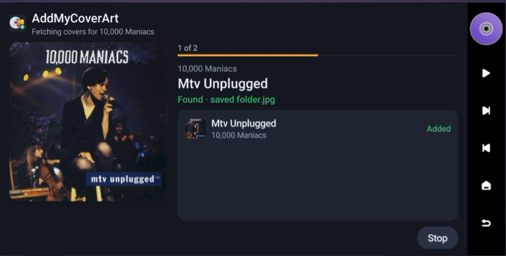

| Choose a folder | Scan results | Report |
|---|---|---|
| 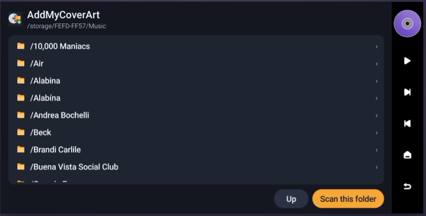 | 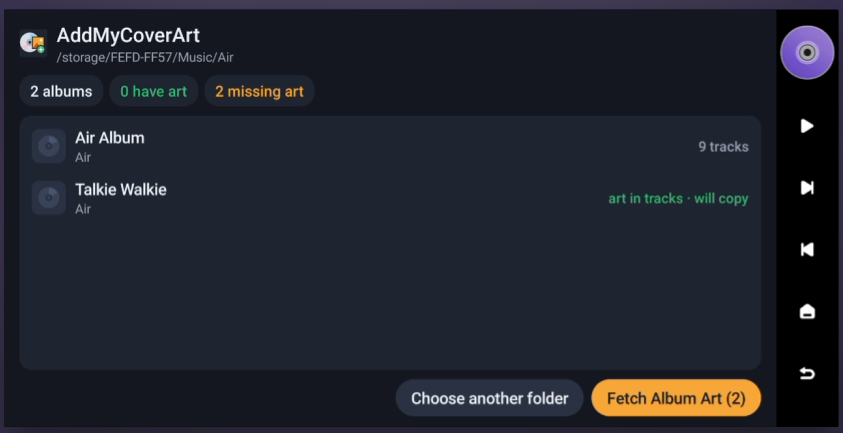 | 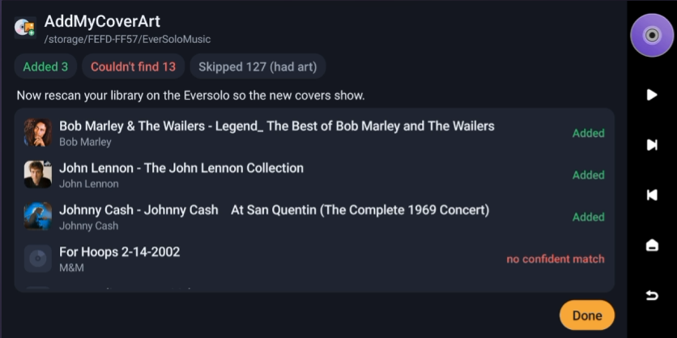 |

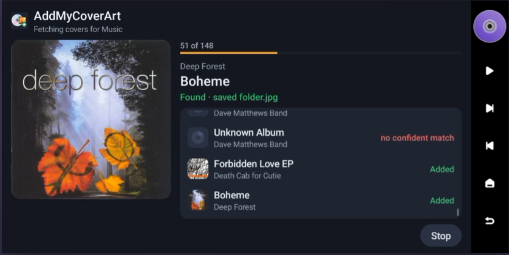

▶ [Short screen recording](docs/screenshots/demo.mp4)

## What it does

1. **Pick a folder** on the internal storage or an attached drive, e.g. `EverSoloMusic`.
2. **Scan.** Every folder with audio files counts as an album. You get a count of albums, how many already have art, and a list of the ones missing it.
3. **Fetch Album Art.** For each album it shows the cover as it is found, saves it, and moves to the next.
4. **Report.** What was added, what couldn't be found and why, and what was skipped. Then rescan your library on the Eversolo so the new covers show.

**It keeps itself up to date.** Once a day it checks for a new version. When one is out, an **Update available** button appears; one tap downloads it, and you install it from the Files app. No computer needed. See [Updating later](#updating-later).

## What it never does

- It never changes, renames, moves or deletes your music, tags or folders.
- It never overwrites art. An album that already has `folder.jpg`, `album.jpg`, `cover.jpg` or `front.jpg` is skipped.
- The only file it ever creates is `folder.jpg`, next to your tracks. Delete it and the album is back how it was.
- No Google Play, no Google services, no accounts, no analytics.

## Where the covers come from

1. **Your own files first.** If the tracks already carry a cover inside them, that exact image is copied out to `folder.jpg`. No internet needed.
2. **MusicBrainz and the Cover Art Archive.** If the album has a MusicBrainz ID (the Eversolo CD Ripper writes one), the matching cover is used. Otherwise it searches by artist and album, using the tags or, failing that, the folder names.

It only uses a match it is confident about: same title, same artist, closest track count. **A skipped album is better than the wrong cover.** Mix CDs, home recordings and obscure compilations will show up as "Couldn't find", which is expected.

The app contacts only `musicbrainz.org` and `coverartarchive.org` for covers, pacing its requests to stay well inside MusicBrainz's limits, plus GitHub (`api.github.com`) at most once a day to see whether a newer version is out. Nothing about you or your music is sent.

## Download

[**AddMyCoverArt-1.0.3.apk**](https://github.com/malbers/addmycoverart/releases/download/v1.0.3/AddMyCoverArt-1.0.3.apk) (from the [v1.0.3 release](https://github.com/malbers/addmycoverart/releases/tag/v1.0.3))

Download it to your laptop or desktop, not to the Eversolo. The next section shows how to get it from your computer onto the Eversolo.

## Install

**What you're doing:** an `.apk` file is an Android app. The Eversolo runs Android underneath, so it can install apps that aren't in its app store, a process usually called "sideloading". There are two ways to get the file onto the Eversolo. Both take a couple of minutes, and you only do this once.

**Before you start:** your computer and the Eversolo must be on the same home network (the same Wi-Fi, or plugged into the same router).

### Option A: the Eversolo's upload page (easiest)

1. **Find the Eversolo's address.** On the Eversolo, go to **Settings > Network Settings > Transfer**. Under **Method 1** it shows a web address that starts with `http://` and ends in `:9587`. Yours will have its own numbers in place of the `192.168.1.x` you'll see in these examples.

   

2. **Open that address on your computer.** Type it exactly as shown, including the `:9587` at the end, into the address bar of any browser (Chrome, Safari, Edge) and press Enter. The Eversolo's upload page opens. Click **Upload Apk** at the right.

   

3. **Send the app.** Click **Select APK File**, find `AddMyCoverArt-1.0.3.apk` where you downloaded it (usually your Downloads folder), and choose it. It uploads and installs on the Eversolo by itself.

   

4. **Find it on the Eversolo.** On the home screen, open the **Apps** tab. AddMyCoverArt is listed first.

   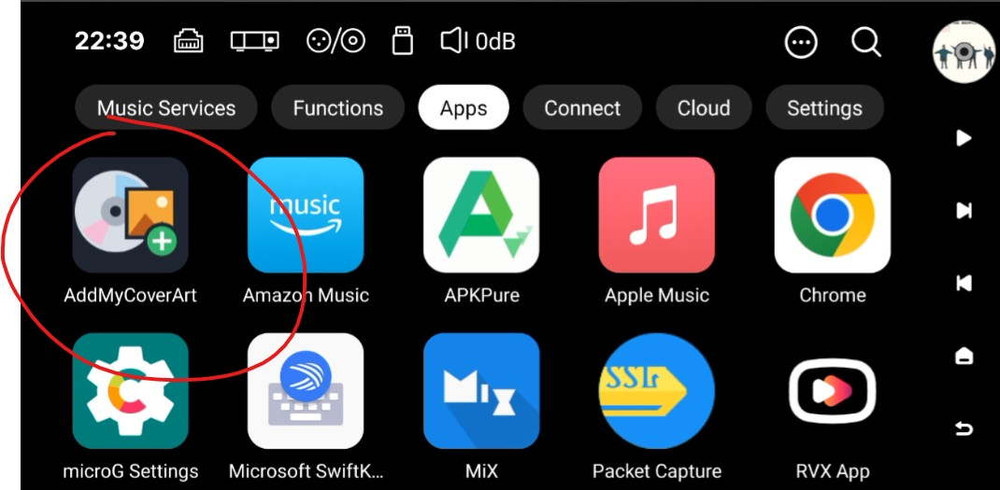

### Option B: copy it over the network, then tap to install

Use this if the upload page doesn't work for you, or if you already copy music to the Eversolo this way.

1. **Find the network share address.** On the same **Transfer** screen, **Method 2** shows an address for Windows (starts with `\\`) and one for Mac (starts with `smb://`).
2. **Open it on your computer.**
   - **Windows:** open File Explorer, click in the address bar at the top, type the `\\` address and press Enter.
   - **Mac:** in Finder, choose **Go > Connect to Server** (or press Cmd+K), type the `smb://` address and click Connect. If it asks how to connect, choose **Guest**.
3. **Copy the APK** into any folder on the Eversolo, for example the `Download` folder on its SSD. Drag it in like any other file.
4. **Install it from the Eversolo.** On the Eversolo, open the built-in **Files** app, go to the folder you used, and tap `AddMyCoverArt-1.0.3.apk`.

   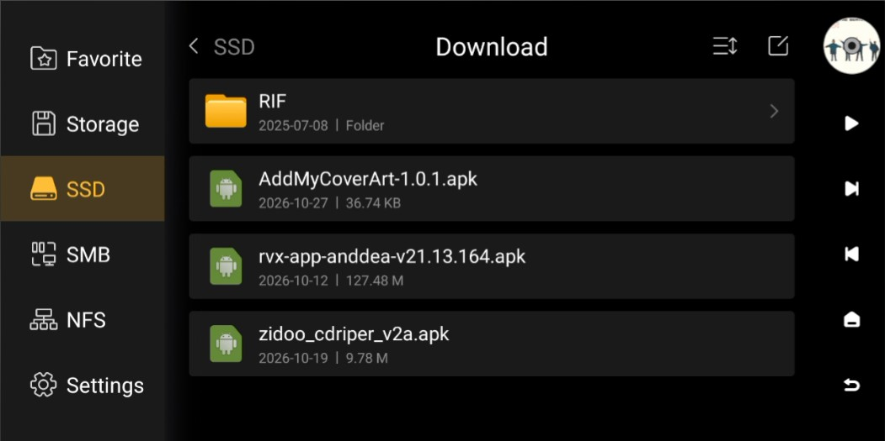

5. **Tap Install.** (If you already have an older version, the message says it will install an update instead. That's fine: nothing you've done in the app is lost.)

   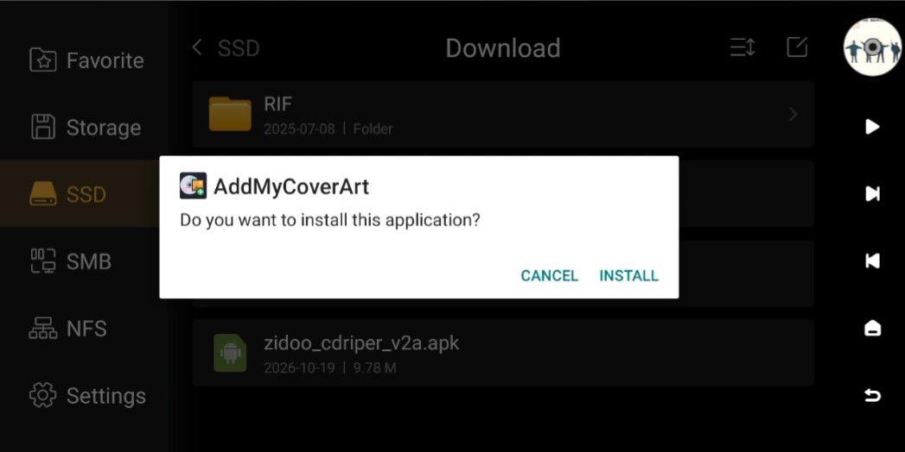

6. **Tap Open** to start it now, or find it later in the **Apps** tab.

   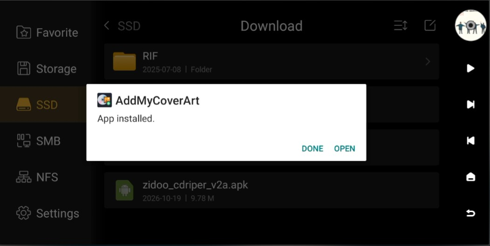

### First launch: give it access to your music

The first time you open it, the app asks for permission to read your music folders and save covers into them. Android asks this in two steps, and both are needed.

1. **Tap Grant access.** The screen explains what the app will and won't do with your files.

   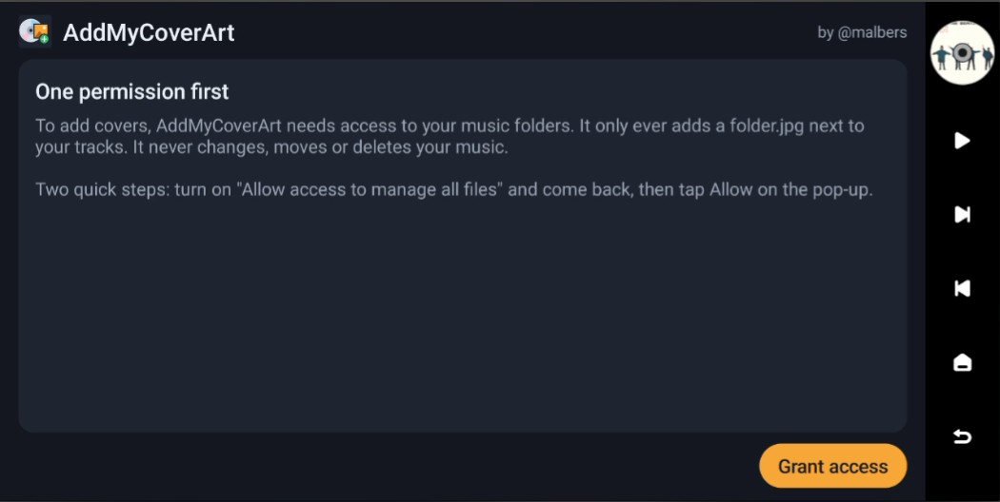

2. **Turn on the switch** next to **Allow access to manage all files**. Android's wording sounds alarming because this is a broad permission. AddMyCoverArt uses it only to read your folders and add `folder.jpg` files. Then press the back arrow (top left) to return to the app.

   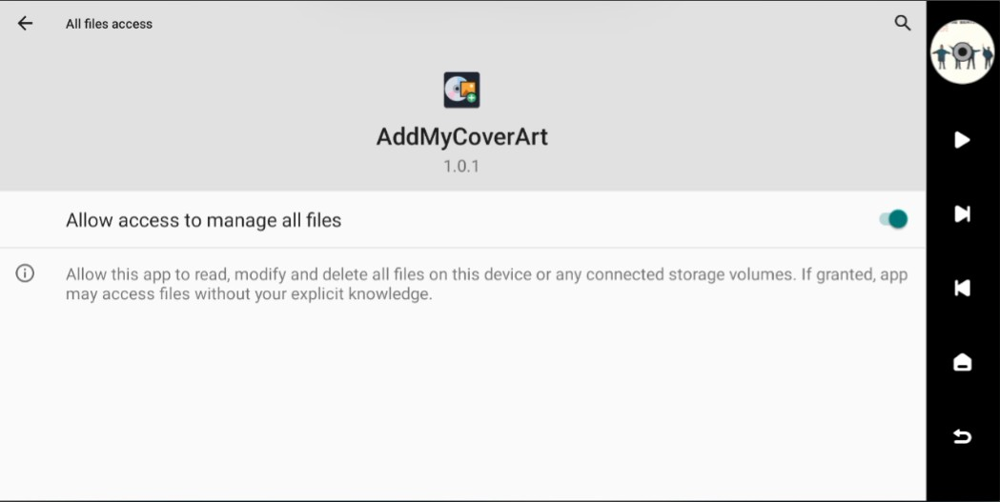

3. **Tap Allow** on the pop-up that follows. That's it: the app opens on the list of your drives, ready to pick a music folder.

   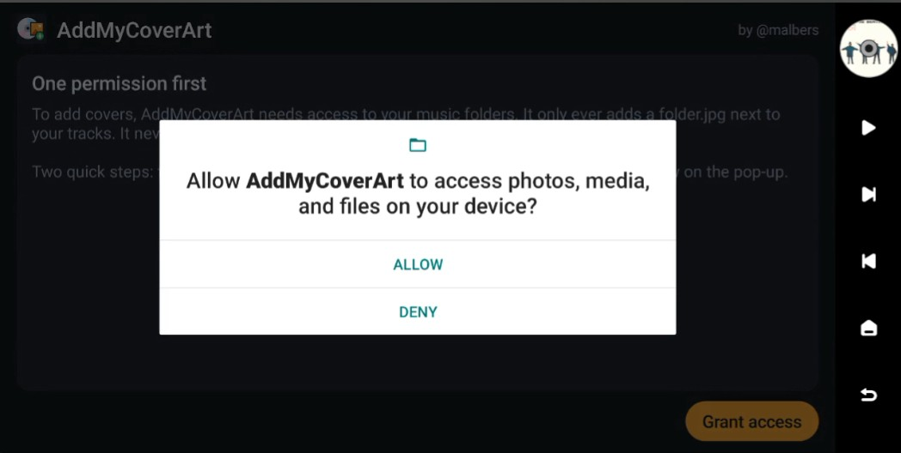

### Updating later

You don't need to come back here to check for new versions: from version 1.0.3 on, the app checks once a day by itself. When there is one, you update right on the Eversolo, with no computer and no browser needed. (Android always asks you to confirm an install, so nothing ever updates without your tap.)

1. **Tap "Update available"** at the bottom left of the app's folder screen.

   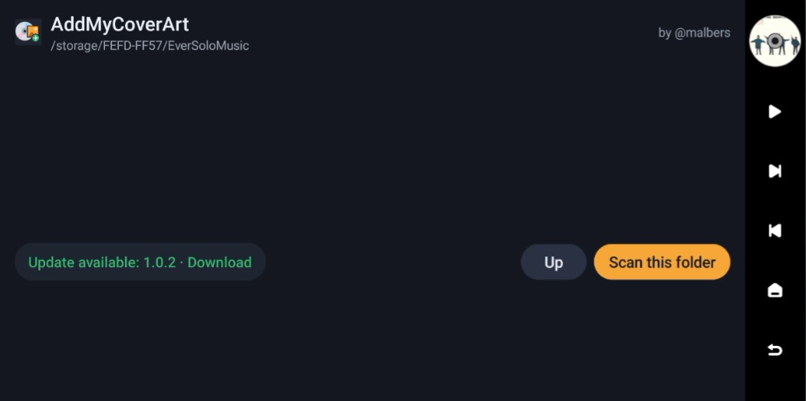

2. **Wait a moment.** It downloads the new version by itself and tells you when it's saved.

   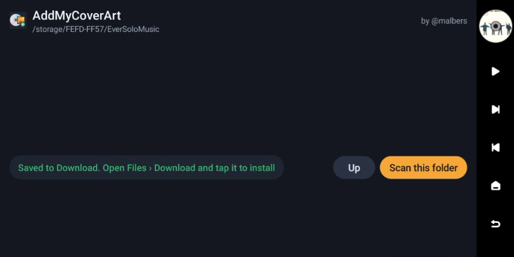

3. **Install it.** Open the **Files** app, choose **Storage** on the left (the Eversolo's own storage, not the SSD), open **Download**, tap the new `AddMyCoverArt` APK and tap **Install**, as in Option B. It installs over the old version; nothing in the app is lost.

You can also download any version from the [releases page](https://github.com/malbers/addmycoverart/releases) on your computer and use Option A or B.

### Is this file really from me?

Every official release is signed with the same key. If you want to check a copy you got somewhere else, its SHA-256 certificate fingerprint should be:

```
388a46435de366c80410d0d38971541700a883781d55f881a13c2c41a5dda3e7
```

An APK with a different signer did not come from here.

## Tested on

Eversolo DMP-A6 (Gen 1), firmware 1.6.15, Android 11, with CD Ripper FLAC rips and an older MP3 library. It should work on other Android-based streamers, but that is untested.

## Building from source

Java, plain Android SDK, no third-party libraries. JDK 17, then:

```
gradlew assembleRelease testDebugUnitTest
```

Release builds are signed with a key kept outside the repo (`scripts/new-signing-key.ps1`); without it they fall back to the debug key.

## Credits

Cover art and album data from [MusicBrainz](https://musicbrainz.org) and the [Cover Art Archive](https://coverartarchive.org), both run by the MetaBrainz Foundation.

## Licence

Copyright 2026 Michael Albers ([@malbers](https://www.youtube.com/@malbers)). Licensed under the [Apache License 2.0](LICENSE).

You're welcome to use it, modify it, build on it and send improvements. If you redistribute it or something built from it, keep the [NOTICE](NOTICE) file with it so the credit travels along. The licence doesn't cover the name: please don't publish a modified version as "AddMyCoverArt" or as coming from me.

Contributions are welcome. Anything you submit to this repository is accepted under the same Apache 2.0 licence.
