# AddMyCoverArt

An APK for the Eversolo DMP (tested on DMP-A6) that fills in missing album art on music already ripped to an Eversolo streamer. Browse your music as covers, see at a glance which albums have none, tap one button, and watch the covers arrive. New in 1.1: find the back cover, booklet pages, disc and tray for any album, and see them in [EverSignal](https://github.com/malbers/eversignal)'s full-screen slideshow while it plays. It can also check your rips for missing, empty or cut-short tracks.

Built for the Eversolo DMP-A6, where CD rips made before the CD Ripper fix often have no artwork. It runs on the device itself, so there is no PC, no network share and no tagging software involved.

> **Made by Michael Albers.** I make honest videos about budget audio equipment, including a lot of Eversolo DMP-A6 how-tos. If this app helped you, come find more on my YouTube channel: **[youtube.com/@malbers](https://www.youtube.com/@malbers)**

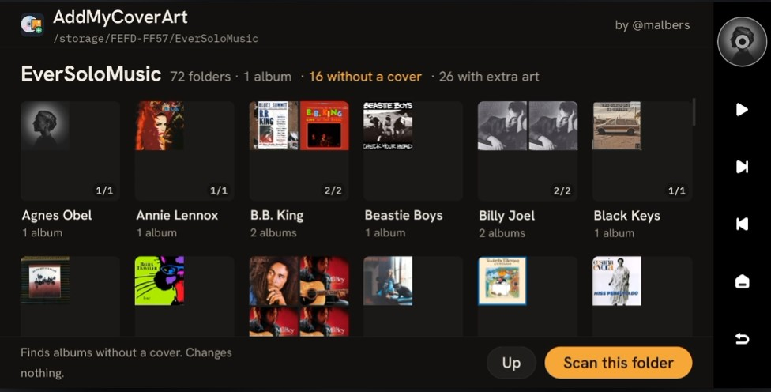

**▶ Watch it in action (43 seconds):** finding the back cover, booklet pages and disc for *Revolver*, looking at them full screen, and saving them for EverSignal.

[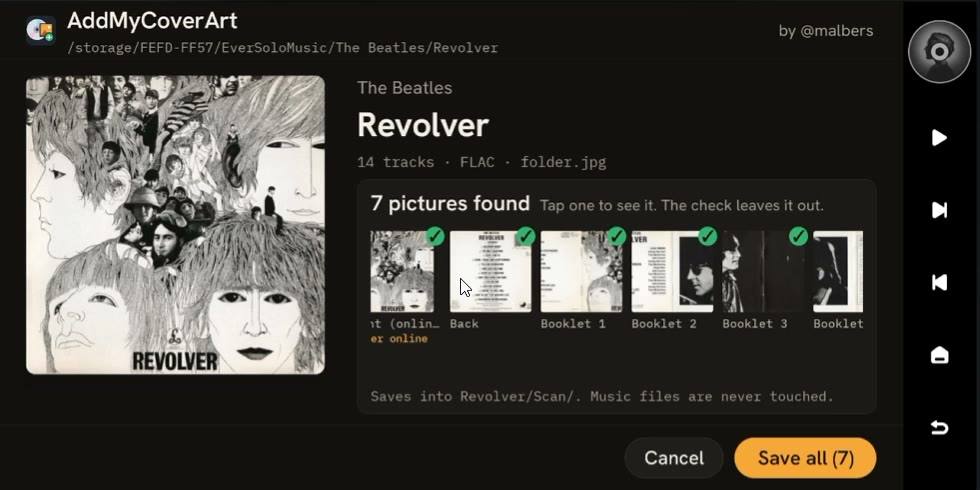](docs/screenshots/v110/find-covers.mp4)

| Find more art | See it before you save it | Saved, ready for EverSignal |
|---|---|---|
| 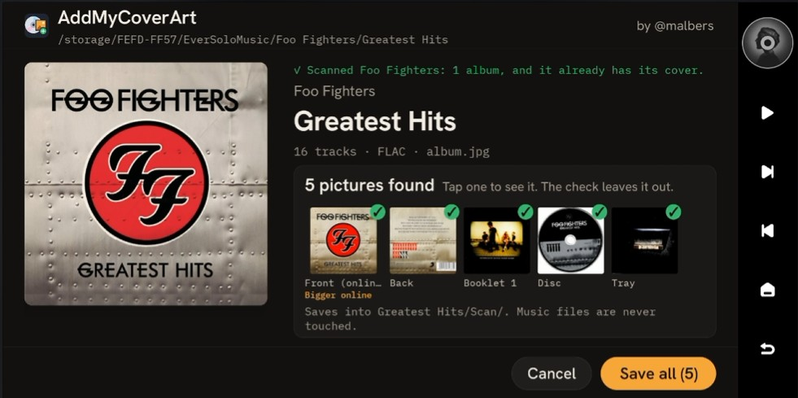 | 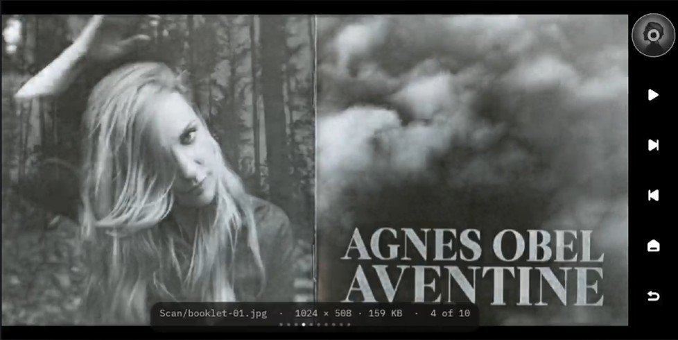 | 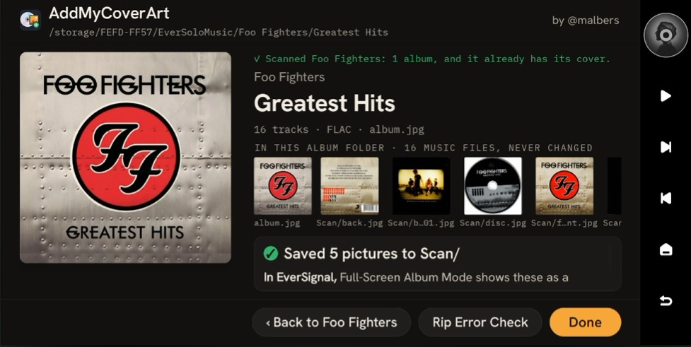 |

| Fetching missing covers | The report: it says why |
|---|---|
| 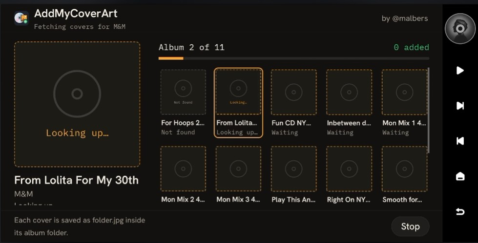 | 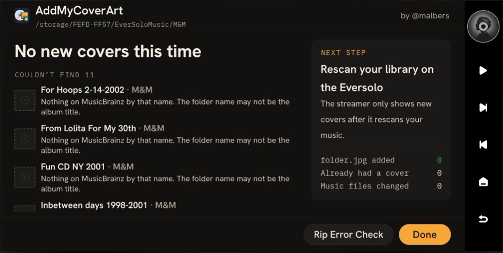 |

[](https://github.com/malbers/addmycoverart/releases)

**Contents**

- [What people are saying](#what-people-are-saying)
- [What it does](#what-it-does)
- [Find more art: booklets, back covers, disc art](#find-more-art-booklets-back-covers-disc-art)
- [What it never does](#what-it-never-does)
- [Where the covers come from](#where-the-covers-come-from)
- [Download](#download)
- [How to Install](#how-to-install)
  - [Option A: from a USB thumb drive](#option-a-from-a-usb-thumb-drive)
  - [Option B: the Eversolo's upload page](#option-b-the-eversolos-upload-page)
  - [Option C: copy it over the network, then tap to install](#option-c-copy-it-over-the-network-then-tap-to-install)
- [What's new](#whats-new)
- [Tested on](#tested-on)
- [Feedback](#feedback)
- [Building from source](#building-from-source)
- [Credits](#credits)
- [Licence](#licence)

## What people are saying

From the *Eversolo DMP-A6 Users & Friends* group on Facebook:

> "Just installed it. It’s found 500 so far first scan. Thank you 🙏"<br>
> **Ian J.**

> "its working for me so far. THANK YOU FOR POSTING THIS!! This saved me so much frustration and time!"<br>
> **Weston T.**

> "It was easy and it works."<br>
> **Matthew A.**

## What it does

1. **Browse your music as covers.** Pick a drive and a folder, e.g. `EverSoloMusic`. Artist folders show a mosaic of their first four covers, albums show their own cover, and an album with no cover shows an orange dashed square, so the gaps jump out.
2. **Scan.** Every folder with audio files counts as an album. You see the albums appear as they are found, then the ones with no cover grouped at the top.
3. **Fetch album art.** For each album it shows the cover as it is found, saves it, and moves to the next. It looks inside your own music files first, then at [MusicBrainz](https://musicbrainz.org) and the [Cover Art Archive](https://coverartarchive.org). See [Where the covers come from](#where-the-covers-come-from). You can stop part-way and pick it up again later.
4. **Report.** The new covers, what couldn't be found and why, and what was skipped.
5. **See the covers.** Open your music library on the Eversolo. It usually picks up the new covers by itself; if some still show a blank disc, run a library rescan.

**Tap any album** to open its page: the big cover, its track count and format, every picture already in the album folder (tap one to see it full screen, with its pixel size), and **Find more art**.

**It spots broken cover files.** A cover file that is empty, or isn't a picture at all (some rips have a PDF booklet named `album.jpg`), doesn't count as a cover. The album is offered a fetch, and the broken file is left exactly where it is.

**It can check your rips.** On the Scan Results screen, **Rip Error Check** compares each album with its release and lists missing tracks, empty tracks and tracks much shorter than they should be. It only reports; it never touches a file. **Save report** keeps the list as a text file in Download.

**It keeps itself up to date.** Once a day it checks for a new version. When one is out, a green **Update** button appears at the top of the screen; tap it to download, then tap **Install**. No computer needed. See [Updating later](#updating-later).

## Find more art: booklets, back covers, disc art

Most CDs came with more than a front cover. Open an album and tap **Find more art for this album**: it looks the album up on MusicBrainz and asks the Cover Art Archive what pictures it has for that exact release, then shows them all: back cover, booklet pages, disc and tray.

| The album page | Looking it up | The back cover, full screen |
|---|---|---|
| 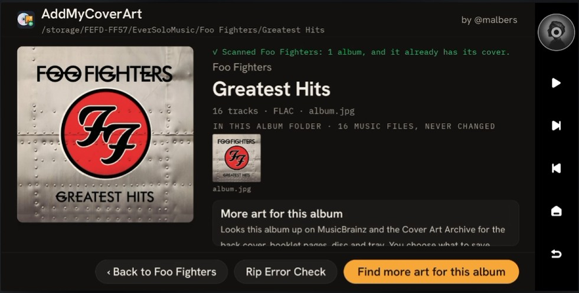 | 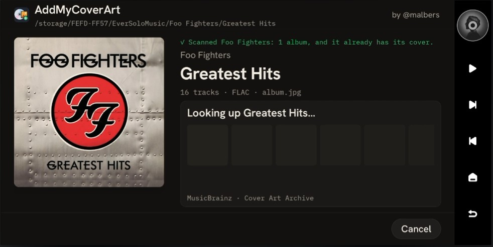 | 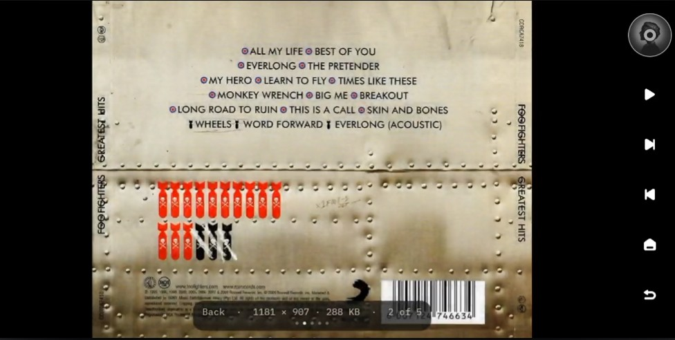 |

- **See before you choose.** Tap any picture to see it full screen, with its size. The check mark on each one leaves it in or out.
- **Save** puts the ones you picked in a `Scan` folder inside the album folder: `back.jpg`, `booklet-01.jpg`, `booklet-02.jpg`, `disc.jpg`, `tray.jpg`. Nothing is ever overwritten; if a name is taken, the new picture gets `-2`.
- **Your cover stays yours.** If the online front cover is clearly bigger than the one you have, it's offered too (marked **Bigger online**) and saved as `Scan/front.jpg`. Your own `folder.jpg` is never replaced. An album with no cover at all gets the front as its `folder.jpg`.
- It works one album at a time, on purpose: which pages you want, and whether the online front beats yours, is your call.

**Works with [EverSignal](https://github.com/malbers/eversignal).** EverSignal's Full-Screen Album Mode shows everything in the `Scan` folder as a slideshow while the album plays. Find the booklet here, then read it there while you listen.

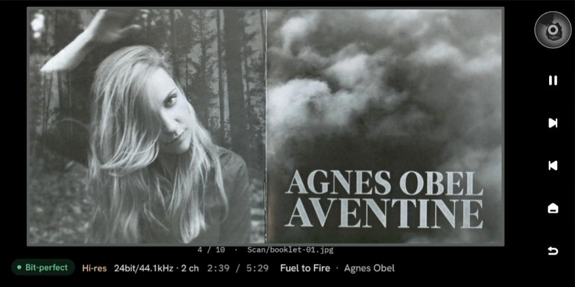

### 🔧 Also from me: FixMyRips

Rip Error Check tells you what's wrong. **[FixMyRips](https://github.com/malbers/fixmyrips)** goes further: it fixes the tags the Eversolo CD Ripper leaves broken (track numbers that start at 0, missing track totals, missing disc numbers), shows every change before making it, and lets you undo any fix. It also lists the discs that need ripping again.

And the bonus: scan a CD's barcode with your phone, standing at your shelf, and it tells you whether that disc is already ripped. Same install as this one. Fill in the covers with AddMyCoverArt, fix the tags with FixMyRips.

### 📊 Also from me: EverSignal

Ever wondered whether your music really reaches your DAC untouched? **[EverSignal](https://github.com/malbers/eversignal)** is a now-playing screen for the Eversolo DMP-A6 that shows the whole signal path, from the file to the output port, and tells you whether it's bit-perfect. It measures each album's dynamic range, shows lyrics, and its Full-Screen Album Mode turns the booklet pages AddMyCoverArt finds into a slideshow while the album plays. Same install as this one.

## What it never does

- It never changes, renames, moves or deletes your music, tags or folders.
- It never overwrites art. An album that already has `folder.jpg`, `album.jpg`, `cover.jpg` or `front.jpg` is skipped, and a picture saved into `Scan` never replaces one that's there.
- In your music folders, it only ever creates `folder.jpg` next to your tracks, and the pictures you pick with Find more art, in the album's `Scan` folder. Delete them and the album is back how it was.
- It never deletes a broken cover file (an empty one, or a PDF named `album.jpg`); it just doesn't count it as a cover.
- The only other files it writes go to the Eversolo's Download folder, and only when you ask: a saved rip report, or a downloaded update.
- No Google Play, no Google services, no accounts, no analytics.

## Where the covers come from

1. **Your own files first.** Many music files carry their album cover inside them. When your tracks do, the app copies that exact image out to `folder.jpg`: your own art, no internet and no guessing. Only albums with no cover inside the files go to step 2.
2. **MusicBrainz and the Cover Art Archive.** [MusicBrainz](https://musicbrainz.org) is a free, community-run database of music releases: which albums exist, which tracks are on them, in which editions. The [Cover Art Archive](https://coverartarchive.org) is its companion library of album cover images. If the album has a MusicBrainz ID (the Eversolo CD Ripper writes one), the matching cover is used. Otherwise it searches by artist and album, using the tags or, failing that, the folder names.

It only uses a match it is confident about: same title, same artist, closest track count. **A skipped album is better than the wrong cover.** Mix CDs, home recordings and obscure compilations will show up as "Couldn't find", which is expected.

The app contacts only `musicbrainz.org` and `coverartarchive.org` for covers and pictures (the Cover Art Archive serves its images from `archive.org`, the Internet Archive), pacing its requests to stay well inside MusicBrainz's limits, plus GitHub (`api.github.com`) at most once a day to see whether a newer version is out. Nothing about you or your music is sent. If MusicBrainz is busy, the app says so and you can try again a minute later.

## Download

[**Download the latest AddMyCoverArt**](https://github.com/malbers/addmycoverart/releases/latest): on the release page, click `AddMyCoverArt-<version>.apk` under **Assets**. This link always points to the newest version.

Download it to your laptop or desktop, not to the Eversolo. The next section shows how to get it from your computer onto the Eversolo.

## How to Install

**What you're doing:** an `.apk` file is an Android app. The Eversolo runs Android underneath, so it can install apps that aren't in its app store, a process usually called "sideloading". There are three ways to get the file onto the Eversolo. Each takes a couple of minutes, and you only do this once.

**For Options B and C:** your computer and the Eversolo must be on the same home network (the same Wi-Fi, or plugged into the same router).

### Option A: from a USB thumb drive

No network needed.

1. **Copy the APK onto a USB thumb drive** (FAT32, exFAT or NTFS, which covers almost any drive).
2. **Plug it into a USB port on the back of the Eversolo.**
3. **Open the Files app**, pick the USB drive in the list on the left, and go to the folder with the APK.
4. **Tap `AddMyCoverArt-<version>.apk`, then Install.** If it asks to allow installs from unknown sources, turn that on for Files.
5. **Tap Done**, then find it in the **Apps** tab.

**Tip:** one thumb drive can carry all three of my Eversolo apps (AddMyCoverArt, [FixMyRips](https://github.com/malbers/fixmyrips) and [EverSignal](https://github.com/malbers/eversignal)), so you can install them in one go.

### Option B: the Eversolo's upload page

1. **Find the Eversolo's address.** On the Eversolo, go to **Settings > Network Settings > Transfer**. Under **Method 1** it shows a web address that starts with `http://` and ends in `:9587`. Yours will have its own numbers in place of the `192.168.1.x` you'll see in these examples.

   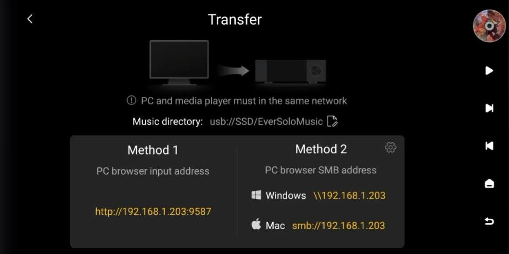

2. **Open that address on your computer.** Type it exactly as shown, including the `:9587` at the end, into the address bar of any browser (Chrome, Safari, Edge) and press Enter. The Eversolo's upload page opens. Click **Upload Apk** at the right.

   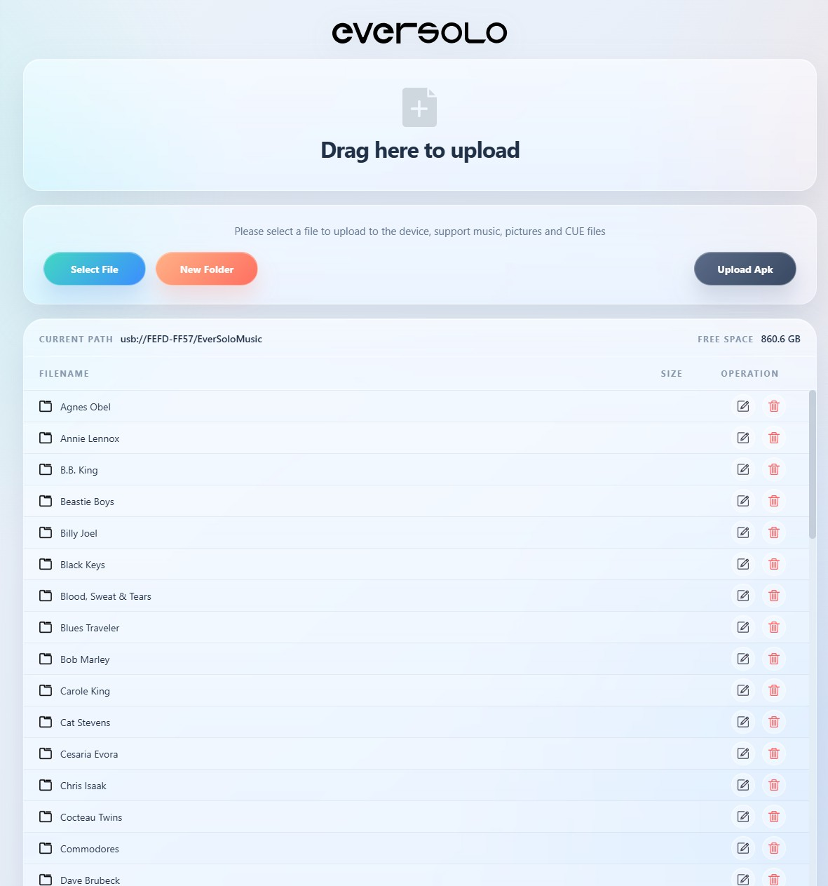

3. **Send the app.** Click **Select APK File**, find `AddMyCoverArt-<version>.apk` where you downloaded it (usually your Downloads folder), and choose it. It uploads and installs on the Eversolo by itself.

   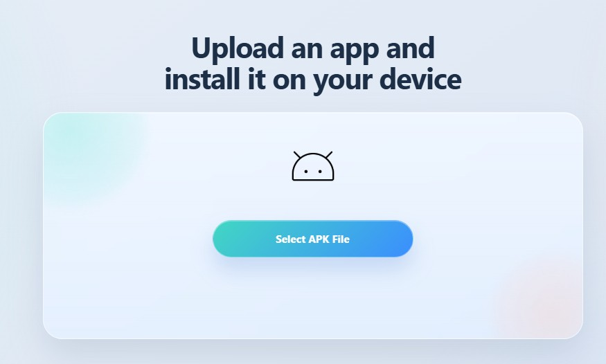

4. **Find it on the Eversolo.** On the home screen, open the **Apps** tab. AddMyCoverArt is listed first.

   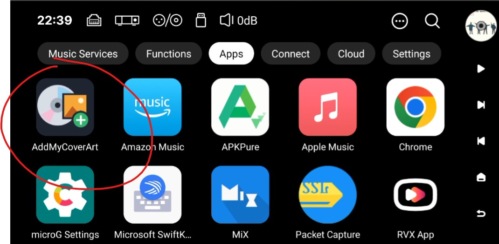

### Option C: copy it over the network, then tap to install

Use this if the upload page doesn't work for you, or if you already copy music to the Eversolo this way.

1. **Find the network share address.** On the same **Transfer** screen, **Method 2** shows an address for Windows (starts with `\\`) and one for Mac (starts with `smb://`).
2. **Open it on your computer.**
   - **Windows:** open File Explorer, click in the address bar at the top, type the `\\` address and press Enter.
   - **Mac:** in Finder, choose **Go > Connect to Server** (or press Cmd+K), type the `smb://` address and click Connect. If it asks how to connect, choose **Guest**.
3. **Copy the APK** into any folder on the Eversolo, for example the `Download` folder on its SSD. Drag it in like any other file.
4. **Install it from the Eversolo.** On the Eversolo, open the built-in **Files** app, go to the folder you used, and tap `AddMyCoverArt-<version>.apk`.

   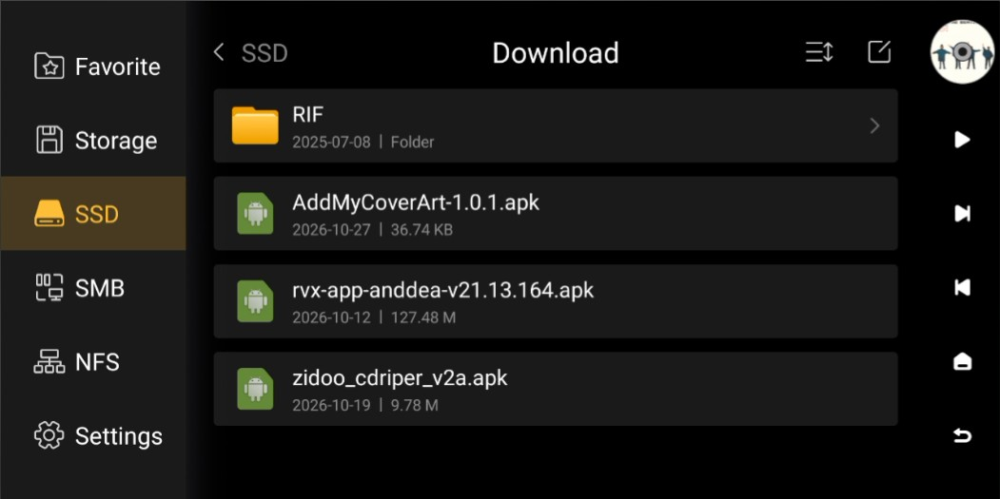

5. **Tap Install.** (If you already have an older version, the message says it will install an update instead. That's fine: nothing you've done in the app is lost.)

   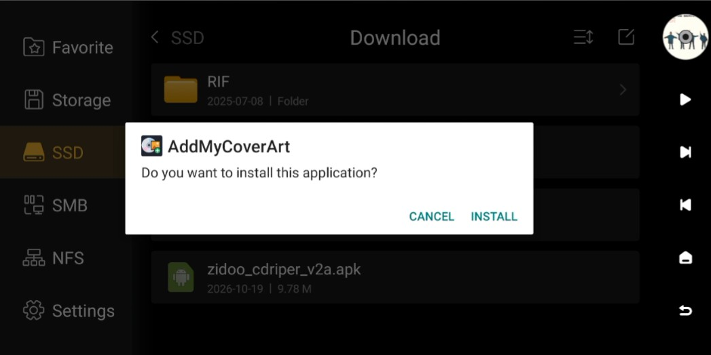

6. **Tap Open** to start it now, or find it later in the **Apps** tab.

   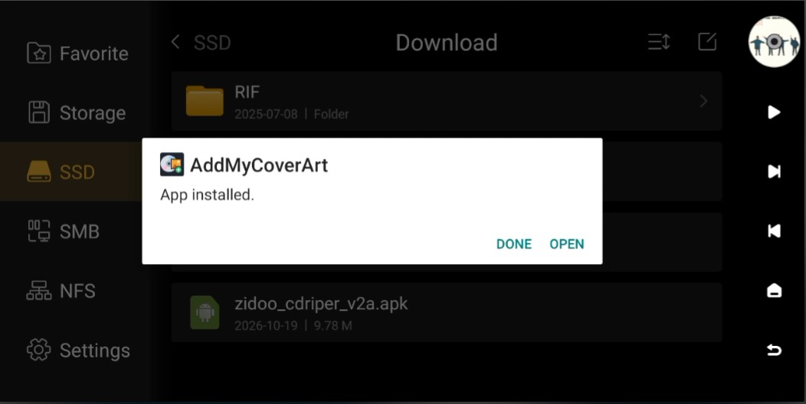

### First launch: give it access to your music

The first time you open it, the app asks for permission to read your music folders and save covers into them. Android asks this in two steps, and both are needed.

1. **Tap Grant access.** The screen explains what the app will and won't do with your files.

   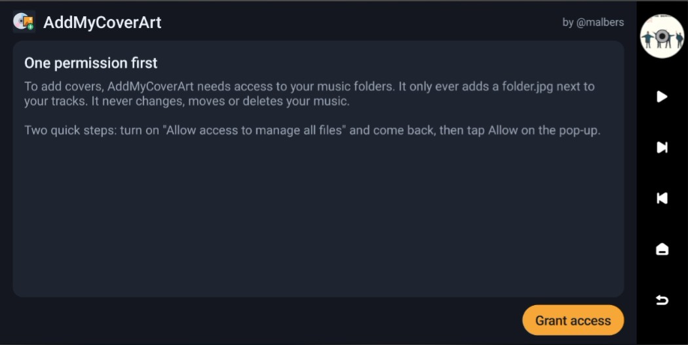

2. **Turn on the switch** next to **Allow access to manage all files**. Android's wording sounds alarming because this is a broad permission. AddMyCoverArt uses it only to read your folders, add `folder.jpg` files and the pictures you pick into `Scan` folders, and save a rip report or an update to Download when you ask. Then press the back arrow (top left) to return to the app.

   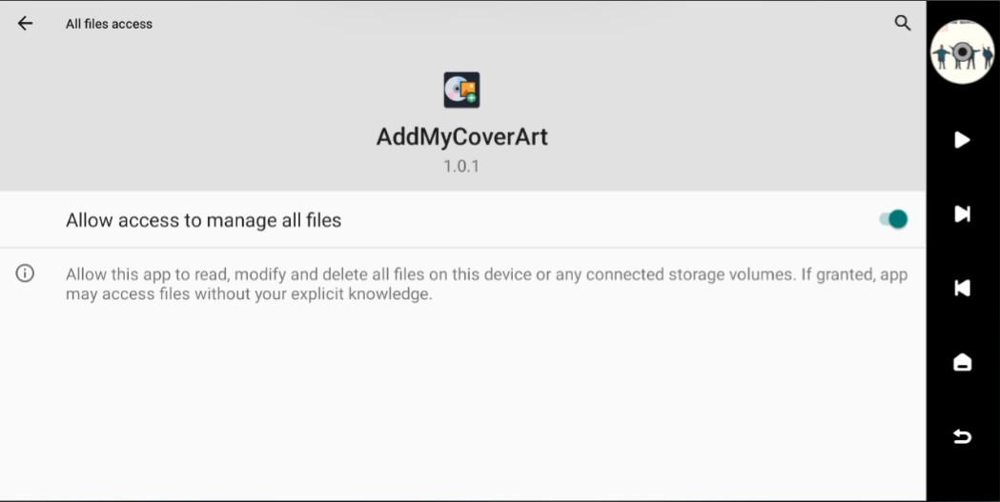

3. **Tap Allow** on the pop-up that follows. That's it: the app opens on the list of your drives, ready to pick a music folder.

   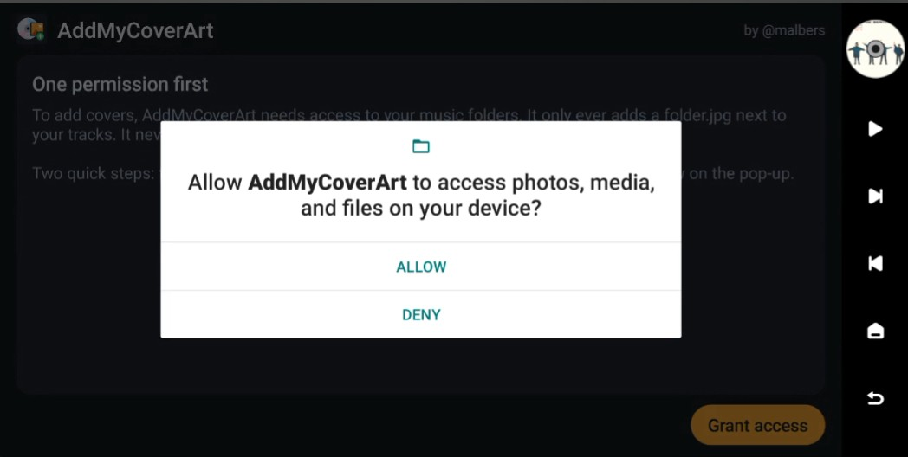

### Updating later

You don't need to come back here to check for new versions: from version 1.0.3 on, the app checks once a day by itself. When there is one, you update right on the Eversolo, with no computer and no browser needed. (Android always asks you to confirm an install, so nothing ever updates without your tap.)

**From 1.1.0:**

1. **Tap the green "Update · Download" button** at the top of the screen, next to "by @malbers". It downloads the new version by itself and shows how far along it is.
2. **Tap "Install".** The first time, Android asks you to allow AddMyCoverArt to install apps: turn on the switch, press back, and tap **Install** again. (This is Android's standard "install unknown apps" permission. AddMyCoverArt only uses it to install its own update, and only when you tap.)
3. **Tap Install** on Android's screen. It installs over the old version; nothing in the app is lost.

**On 1.0.4 or earlier:**

1. **Tap "Update available"** at the bottom left of the app's folder screen.

   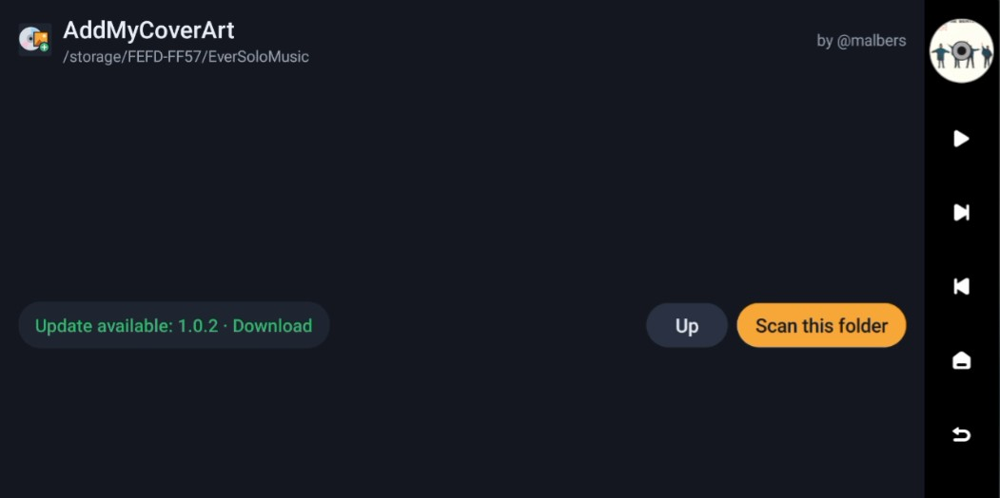

2. **Wait a moment.** It downloads the new version by itself and tells you when it's saved.

   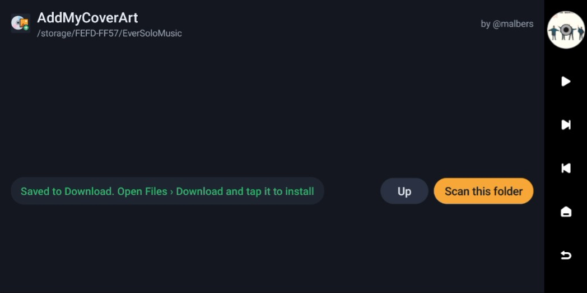

3. **Install it.** Open the **Files** app, choose **Storage** on the left (the Eversolo's own storage, not the SSD), open **Download**, tap the new `AddMyCoverArt` APK and tap **Install**, as in Option C. It installs over the old version; nothing in the app is lost.

**If a browser opens instead.** On a few Eversolos the download goes through Chrome rather than straight to the Download folder. It's just three extra taps:

- **Pick Chrome** and tap **Just once**.

  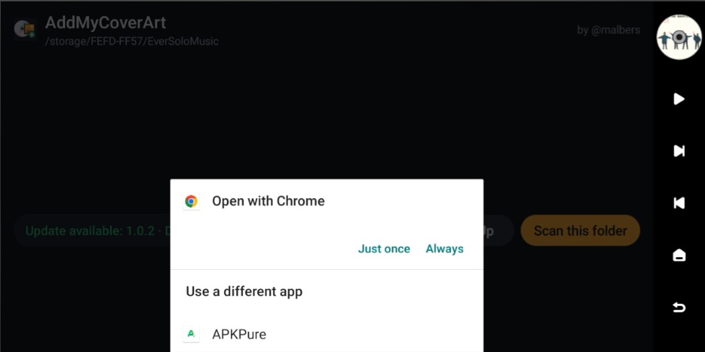

- **Leave it on Downloads** and tap **Download**.

  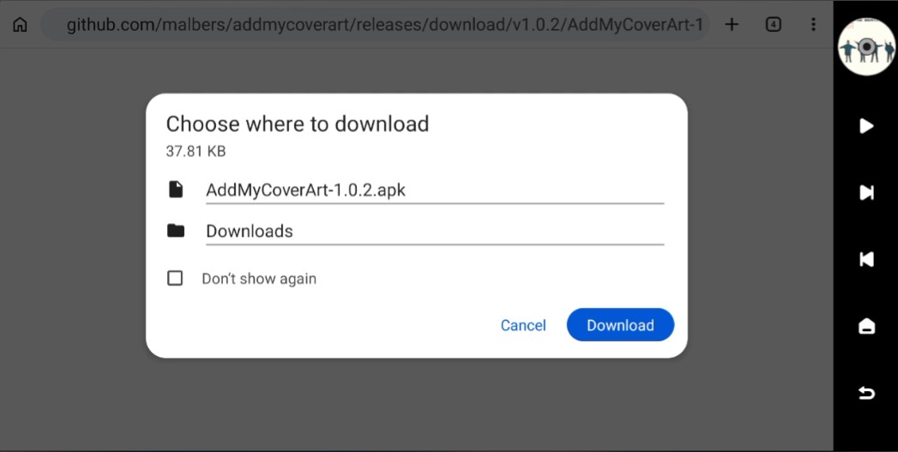

- **Tap Download anyway.** Chrome shows this warning for every APK; it doesn't mean anything is wrong with this one.

  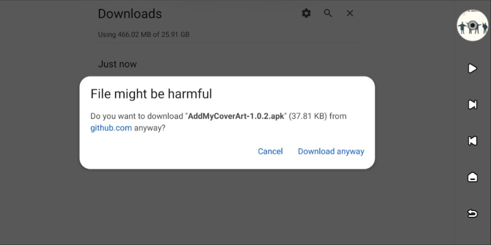

Then install it as in step 3.

You can also download any version from the [releases page](https://github.com/malbers/addmycoverart/releases) on your computer and use any of the options above.

### Is this file really from me?

Every official release is signed with the same key. If you want to check a copy you got somewhere else, its SHA-256 certificate fingerprint should be:

```
388a46435de366c80410d0d38971541700a883781d55f881a13c2c41a5dda3e7
```

An APK with a different signer did not come from here.

## What's new

Newest first. Every version is also on the [releases page](https://github.com/malbers/addmycoverart/releases).

**1.1.0** (23 November 2026)
- **Find more art!** Open any album and find its back cover, booklet pages, disc and tray on the Cover Art Archive. See each one full screen, pick the ones you want, and they're saved in the album's `Scan` folder, ready for [EverSignal](https://github.com/malbers/eversignal)'s Full-Screen Album Mode slideshow. If the online front cover is bigger than yours, it's offered too, and your own cover is never replaced. Thanks to Václav H., whose love of CD booklets gave me the idea.
- **Covers everywhere!** A completely new look: browse your music as covers, with artist folders as mosaics and albums without a cover marked in orange. Scan results, fetching and the report are all cover grids now.
- **A page for every album.** Tap any album to see its cover, every picture in its folder (full screen, with pixel size) and what's missing.
- **See what's left to fill in.** Albums with extra art show a small badge (**+8**), artist folders show how many of their albums have it (**2/5**), so the ones still waiting for a booklet stand out.
- **Broken cover files are spotted.** An empty `album.jpg` or a PDF booklet saved as `album.jpg` no longer counts as a cover, so those albums finally get one. The broken file is left alone.
- **Stop and resume** a long fetch, and **Try again** if the network drops or MusicBrainz is busy.
- **Update from the app** with one more tap: the update button now installs the new version directly.
- Long folder paths and album names scroll so you can read the end (Disc 1 or Disc 2?), and Back and Up return to where you were.

**1.0.4** (28 October 2026)
- **New: Rip Error Check.** A separate button at the bottom left of Scan Results. For each album it compares your folder with the release on MusicBrainz (or with the track numbers and totals in the tags) and lists missing tracks, empty tracks, and tracks much shorter than the release. It only reports; it never changes, renames or deletes anything. An album it can't match with confidence is counted as "Not checked", never guessed.
- **Save report** writes the full list, including what wasn't checked, as a text file to the Eversolo's Download folder, so you can print it and work through it.
- On my own library it checked 112 albums and found 6 real problems: missing tracks, a rip that failed partway through, and empty files. No false alarms.

**1.0.3** (27 October 2026)
- **The app now checks for updates.** Once a day it looks for a newer version. When one is out, an **Update available** button appears at the bottom left of the folder screen. Tap it and the new version downloads to the Eversolo's Download folder; install it from the Files app. No computer or browser needed.
- If you're on 1.0.2 or earlier, install 1.0.3 by hand once (see [How to Install](#how-to-install)). After that, updates come to you.

## Tested on

Eversolo DMP-A6 (Gen 1), firmware 1.6.15, Android 11, with CD Ripper FLAC rips and an older MP3 library. It should work on other Android-based streamers, but that is untested. Find more art is tested with EverSignal 1.0.13's Full-Screen Album Mode.

## Feedback

Found a bug, have an idea, or got a question? **[Tell me here](https://docs.google.com/forms/d/e/1FAIpQLSdjVVL_qZD5tC7SnQKodsrbxz4l9FdBz-dS77bGRA5S5a21bQ/viewform)**. It's a short form, no account needed, and I read every one. If you're on GitHub, you can also [open an issue](https://github.com/malbers/addmycoverart/issues).

## Building from source

Java, plain Android SDK, no third-party libraries. JDK 17, then:

```
gradlew assembleRelease testDebugUnitTest
```

Release builds are signed with a key kept outside the repo (`scripts/new-signing-key.ps1`); without it they fall back to the debug key.

## Credits

Cover art and album data from [MusicBrainz](https://musicbrainz.org) and the [Cover Art Archive](https://coverartarchive.org), both run by the MetaBrainz Foundation.

## Licence

Copyright 2026 Michael Albers ([@malbers](https://www.youtube.com/@malbers)). Licensed under the [Apache License 2.0](LICENSE).

You're welcome to use it, modify it, build on it and send improvements. If you redistribute it or something built from it, keep the [NOTICE](NOTICE) file with it so the credit travels along. The licence doesn't cover the name: please don't publish a modified version as "AddMyCoverArt" or as coming from me.

Contributions are welcome. Anything you submit to this repository is accepted under the same Apache 2.0 licence.

Also from me: [FixMyRips](https://github.com/malbers/fixmyrips) fixes the tags on the same Eversolo rips, and tells you from your phone whether a CD is already ripped. [EverSignal](https://github.com/malbers/eversignal) shows what your DMP-A6 is playing, all the way to the DAC, and whether it is bit-perfect.
